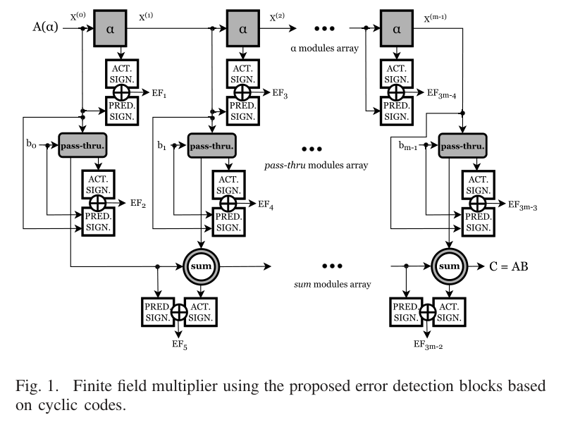
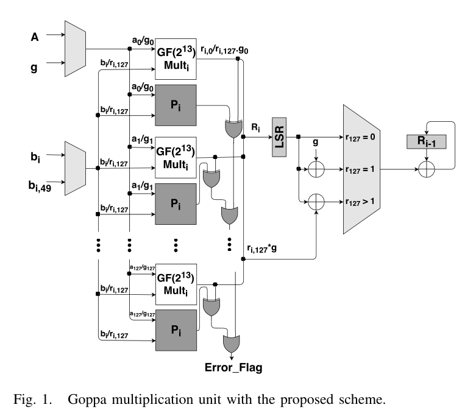
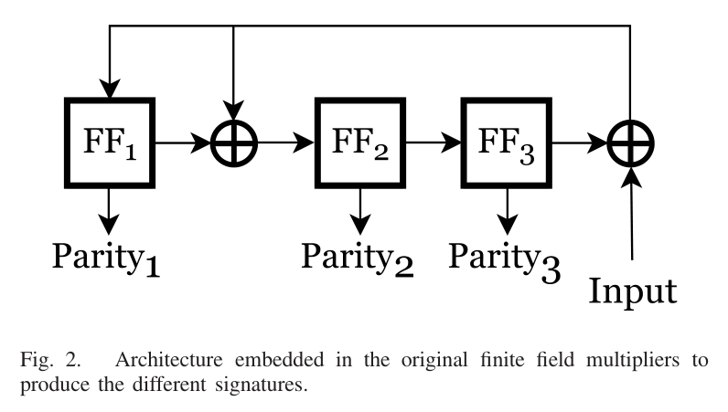

# CED for composite-field Goppa / GF multipliers (McEliece)

**Prereqs:** [Goppa and alternant](goppa-alternant.md) · [Finite fields beyond F₂](../bridge/finite-fields-beyond-f2.md) · [Side-channel threat model](../bridge/side-channel-threat-model.md) · helpful: [Fault attacks on hash sigs](fault-attacks-hash-sigs.md)  
**Next:** [Code-based signatures](code-based-signatures.md) (naming trap) · [Carryless $\mathbb{F}_2$ polymul](carryless-polymul-f2.md) (different code HW) · [Fault attacks on hash sigs](fault-attacks-hash-sigs.md) · Track: [Code-based KEMs](../tracks/code-based-kems/ROADMAP.md) · [PQC hardware § code](../tracks/pqc-hardware/ROADMAP.md#family-hw-leaves-code)  
**Tracks:** code-based-kems · pqc-hardware

**Learning goals.** After this page you can:

- Separate **CED “signatures”** (error-detecting check bits) from **digital signatures** (Sign/Verify)  
- Sketch why Classic McEliece HW lives in **composite / extension-field** Goppa arithmetic  
- Contrast **multi-part parity CED** (TCAD Goppa units) with **cyclic-code CED** on $\mathrm{GF}(2^m)$ multipliers (TVLSI)  
- Open the two curated reliability leaves without treating them as full KEM SoCs  

## The one idea

McEliece’s secret Goppa world needs many finite-field ops (mul, square, invert, GCD, evaluate, …).  
Hardware that implements those ops can be hit by **natural soft errors** or **intentional fault injection** [[1]](#ref-1) [[2]](#ref-2).  

**Concurrent error detection (CED)** watches the datapath *while it runs*: each module computes a small **check fingerprint** (the papers call this a *signature*) from the outputs and compares it to a **predicted** fingerprint from the inputs. Mismatch → `Error_Flag` / `EF_i`.

[[1]](#ref-1) (TCAD §I) states the naming trap explicitly: here “signature” means **appended error-detecting bits**, not cryptographic authenticity signatures.

| Threat / tool | What it protects | Curriculum cousin |
|---------------|------------------|-------------------|
| Power / EM SCA | Leakage of secrets | [Masking](masking-shares.md) · [shuffling](shuffling-hiding.md) |
| Fault injection (FIA) | Wrong intermediates / forged paths | [Hash-sig faults](fault-attacks-hash-sigs.md) |
| **CED** | Detect that arithmetic output is inconsistent | This card |

## Composite-field McEliece postcard (from TCAD)

[[1]](#ref-1) §II–III case study uses Classic McEliece-shaped parameters $m=13$, $t=128$, $n=8192$ and works in **three** fields at once:

1. Goppa field $\mathrm{GF}((2^m)^t)$ — polynomials of degree $<t$ with coefficients in $\mathrm{GF}(2^m)$  
2. Coefficient field $\mathrm{GF}(2^{13})$ with irreducible $p(x)=x^{13}+x^4+x^3+x+1$  
3. Bits $\mathrm{GF}(2)$

**Composite-field-oriented** here means: Goppa arithmetic is built from many $\mathrm{GF}(2^m)$ coefficient ops (Table I: division, mul/add, squaring, square root, GCDIPD, GPE).  
That is the layer CED wraps — not the public scrambled binary matrix alone.

Polynomial-basis multiply over $\mathrm{GF}(2^m)$ reuses three leaf modules ([[1]](#ref-1) §III-A; same skeleton in [[2]](#ref-2) §II):

| Module | Job |
|--------|-----|
| $\alpha$ | Multiply by $x$ (or $\alpha$) and reduce mod the field polynomial |
| **pass-thru** | Multiply a field element by a single bit |
| **sum** | XOR / add two field elements |

**Figure 1.** Polynomial-basis $\mathrm{GF}(2^m)$ multiplier with actual and predicted cyclic-code signature blocks and per-module error flags $EF_i$. [Reproduced from: A. Cintas-Canto, M. Mozaffari Kermani, and R. Azarderakhsh, “Reliable architectures for finite field multipliers using cyclic codes on FPGA utilized in classic and post-quantum cryptography,” *IEEE Trans. Very Large Scale Integr. (VLSI) Syst.*, vol. 31, no. 1, pp. 157–161, Jan. 2023, Fig. 1 [[2]](#ref-2). © 2023 IEEE]

### Mid-page self-check

Does asserting `Error_Flag` mean the ciphertext failed IND-CCA?

Answer

No. It means a **protected arithmetic unit** saw actual vs predicted check bits disagree. Crypto API security is a different layer.

## Two CED recipes on the track

### A — Multi-part parity on Goppa units (TCAD)

Single parity on $\mathrm{GF}(2^m)$ words only catches **odd-weight** faults ([[1]](#ref-1) §III-A, citing Reyhani–Hasan).  
[[1]](#ref-1) raises coverage with:

- **Normal** signature (one parity flag per module)  
- **Two-part** — split 13 bits into $\{0..6\}$, $\{7..12\}$  
- **Three-part** — $\{0..4\}$, $\{5..9\}$, $\{10..12\}$  

Predicted parities for sum / pass-thru are XOR or bit-AND of block parities; $\alpha$ and squaring get closed-form predicted parities (Theorems 1–4).  
[[1]](#ref-1) wraps a **schoolbook Goppa mul** (chain of coefficient $\mathrm{GF}(2^{13})$ muls, each with a shaded $P_i$ predictor) so any bad mul asserts `Error_Flag` (Figure 2):

**Figure 2.** Goppa multiplication unit with per-coefficient $P_i$ predictors OR-ed into `Error_Flag`. [Reproduced from: A. Cintas Canto, M. Mozaffari Kermani, and R. Azarderakhsh, “Reliable architectures for composite-field-oriented constructions of McEliece post-quantum cryptography on FPGA,” *IEEE Trans. Comput.-Aided Design Integr. Circuits Syst.*, vol. 40, no. 5, pp. 999–1003, May 2021, Fig. 1 [[1]](#ref-1). © 2021 IEEE]

FPGA numbers in the paper are for the **GPE** (Horner evaluation) unit on Kintex-7 / Spartan-7 — not a full KeyGen/Dec SoC ([[1]](#ref-1) §IV).

### B — Cyclic-code signatures on GF multipliers (TVLSI)

[[2]](#ref-2) §I: 1-bit parity ≤ ~50% coverage (misses even-weight faults); multiparity still struggles with **burst / clumped** injections.  
They embed a systematic **(7,4) cyclic code** ($g(x)=x^3+x+1$) so each $\alpha$ / sum / pass-thru module carries **actual vs predicted** 3-bit parity triples (Figures 1 and 3; [[2]](#ref-2)).  

**Figure 3.** LFSR-style encoder producing Parity$_1$/$_2$/$_3$ for the (7,4) cyclic signature ($g(x)=x^3+x+1$). [Reproduced from: A. Cintas-Canto, M. Mozaffari Kermani, and R. Azarderakhsh, “Reliable architectures for finite field multipliers using cyclic codes on FPGA utilized in classic and post-quantum cryptography,” *IEEE Trans. Very Large Scale Integr. (VLSI) Syst.*, vol. 31, no. 1, pp. 157–161, Jan. 2023, Fig. 2 [[2]](#ref-2). © 2023 IEEE]

Fields tabulated ([[2]](#ref-2) Table I) include AES $\mathrm{GF}(2^8)$, **McEliece $\mathrm{GF}(2^{13})$** (same irreducible as TCAD), WG-16, WG-29.  
Coverage slogan ([[2]](#ref-2) Table IV): with $s$ module signatures,

$$
100\cdot\bigl(1-2^{-s}\bigr)\%,
$$

e.g. $s=37$ for $\mathrm{GF}(2^{13})$ ($12\alpha + 12\mathrm{sum} + 13\mathrm{pass}$).  
Artix-7 fault sims on $\mathrm{GF}(2^8)$: normal parity ~50%; (7,4) cyclic >99.9% of injected faults ([[2]](#ref-2) §IV).

| Leaf | Scope | CED style |
|------|--------|-----------|
| TCAD composite McEliece [[1]](#ref-1) | Goppa units (mul, GCDIPD, GPE, …) | Multi-part / predicted parity |
| TVLSI cyclic GF mul [[2]](#ref-2) | Coefficient $\mathrm{GF}(2^m)$ multiplier (McEliece among fields) | (7,4) cyclic actual/predicted |

## Common confusions

- CED signature ≠ Dilithium / SPHINCS+ / LEDAsig **digital signature**.  
- Composite-field Goppa arith ≠ quasi-cyclic HQC/BIKE polymul ([carryless](carryless-polymul-f2.md)).  
- High analytic $1-2^{-s}$ coverage ≠ laser/EM campaign done for every unit (TCAD measures GPE PPA; TVLSI fault-sims $\mathrm{GF}(2^8)$).  
- Protecting a multiplier ≠ a complete Classic McEliece accelerator.

## Check yourself

1. Name the three leaf modules inside the PB $\mathrm{GF}(2^m)$ multiply skeleton.  

Answer

$\alpha$, pass-thru, and sum [[1]](#ref-1) [[2]](#ref-2).

2. Why does [[1]](#ref-1) split parities into two- or three-part signatures?  

Answer

Single parity misses even-weight faults; splitting raises coverage for the same $\mathrm{GF}(2^{13})$ datapath.

3. What field size ties the TVLSI McEliece row to Classic McEliece Goppa coeffs?  

Answer

$\mathrm{GF}(2^{13})$ with $x^{13}+x^4+x^3+x+1$ [[2]](#ref-2) Table I.

## Next steps

- [Goppa and alternant](goppa-alternant.md) · [Finite fields beyond F₂](../bridge/finite-fields-beyond-f2.md)  
- Naming trap: [Code-based signatures](code-based-signatures.md) (Sign/Verify, not CED check bits)  
- Other code HW: [Carryless $\mathbb{F}_2$ polymul](carryless-polymul-f2.md) · [Crypto-agile SoC](crypto-agile-soc.md)  
- Threat cousins: [Fault attacks on hash sigs](fault-attacks-hash-sigs.md) · [ASA / HPC fuzzing](asa-hpc-fuzzing.md) · [Side-channel threat model](../bridge/side-channel-threat-model.md)  
- Extracts:  
  - `papers/tcad-pqc/reliable-architectures-for-composite-field-oriented-constructions-of-mceliece-post-quantum-cryptography-on-fpga/paper.md`  
  - `papers/tvlsi-pqc/Reliable Architectures for Finite Field Multipliers Using Cyclic Codes on FPGA Utilized in Classic and Post-Quantum Cryptography/paper.md`  
- [Code-based ROADMAP](../tracks/code-based-kems/ROADMAP.md) · [PQC hardware § code](../tracks/pqc-hardware/ROADMAP.md#family-hw-leaves-code)

## References

[1] A. Cintas Canto, M. Mozaffari Kermani, and R. Azarderakhsh, “Reliable architectures for composite-field-oriented constructions of McEliece post-quantum cryptography on FPGA,” *IEEE Trans. Comput.-Aided Design Integr. Circuits Syst.*, vol. 40, no. 5, pp. 999–1003, May 2021, doi: [10.1109/TCAD.2020.3019987](https://doi.org/10.1109/TCAD.2020.3019987).

[2] A. Cintas-Canto, M. Mozaffari Kermani, and R. Azarderakhsh, “Reliable architectures for finite field multipliers using cyclic codes on FPGA utilized in classic and post-quantum cryptography,” *IEEE Trans. Very Large Scale Integr. (VLSI) Syst.*, vol. 31, no. 1, pp. 157–161, Jan. 2023, doi: [10.1109/TVLSI.2022.3224357](https://doi.org/10.1109/TVLSI.2022.3224357).
