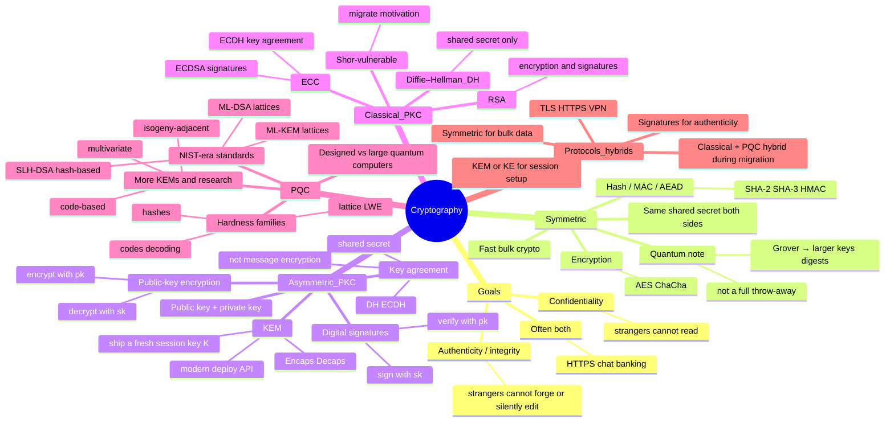

# Crypto categories — a mindmap

**Prereqs:** [Motivation](motivation.md) · [History](history.md) · [Challenges](challenges.md) (recommended)  
**Next:** [How to read the math](../fundamentals/reading-math-notation.md) · [Why cryptography?](../fundamentals/why-cryptography.md) · [Public-key picture](../fundamentals/public-key-picture.md)

**Learning goals.** Place confidentiality vs authenticity, symmetric vs asymmetric (PKC), encryption vs signatures vs key agreement vs KEMs, classical PKC vs PQC, and “protocols bundle tools” on one mental map — before the math pages.

## Why this map exists

Later pages dive into codes, lattices, and hardware. This page is the **folder tree**: what kinds of crypto tools exist, what job each does, and how PQC fits.

Skip freely; come back when a word feels fuzzy. Glossary: [PKC](../glossary.md#pkc) · [KEM](../glossary.md#kem) · [PQC](../glossary.md#pqc).

## The mindmap

Zoom / scroll if your browser clips the edges. Branches are slogans, not full courses.

## Branch guide (read after the map)

### 1. Goals (what crypto is *for*)

| Goal | Plain English | Typical tools |
|------|---------------|---------------|
| **Confidentiality** | Strangers cannot *read* the content | Encryption (symmetric or public-key), then usually AEAD |
| **Authenticity / integrity** | Strangers cannot *forge or silently edit* | Signatures, MACs, authenticated encryption |

You can have one without the other. Real apps usually need **both**.  
Deeper toys: [Why cryptography?](../fundamentals/why-cryptography.md).

### 2. Symmetric vs asymmetric (PKC)

| | **Symmetric** | **Asymmetric / PKC** |
|--|---------------|----------------------|
| Keys | Same secret on both sides | Public key + private key |
| Strength | Very fast for bulk data | Heavier; great for *first meeting* |
| First-contact problem | How do strangers share the secret? | Designed for this |
| Quantum slogan | Grover → larger margins | Shor breaks classical RSA / DH / ECC |

**Asymmetric** and **public-key cryptography (PKC)** mean the same family here.  
Glossary: [Symmetric crypto](../glossary.md#symmetric-crypto) · [Asymmetric / PKC](../glossary.md#asymmetric-pkc) · [PKC](../glossary.md#pkc).

### 3. Four PKC *jobs* (do not mix the APIs)

| Job | Who uses which key | What you get |
|-----|--------------------|--------------|
| **Public-key encryption** | Encrypt with $\mathsf{pk}$; decrypt with $\mathsf{sk}$ | Confidentiality of a message |
| **Digital signature** | Sign with $\mathsf{sk}$; verify with $\mathsf{pk}$ | Authenticity / integrity |
| **Key agreement** (e.g. DH / ECDH) | Both contribute; output a **shared secret** | A session secret — *not* “encrypt this email” by itself |
| **KEM** | $\mathsf{Encaps}(\mathsf{pk})\to(\mathsf{ct},K)$; $\mathsf{Decaps}(\mathsf{sk},\mathsf{ct})\to K$ | Fresh session key $K$ under a clean API |

Modern deployments lean on **KEMs** (and signatures) more than raw “encrypt a whole file with RSA.”  
Story page: [Public-key picture](../fundamentals/public-key-picture.md) · concept: [KEM](../concepts/kem.md).

### Quick self-check

Diffie–Hellman gives two parties a shared secret. Is that the same API as “encrypt a message under Alice’s public key”?  

Answer

No — DH is <strong>key agreement</strong>. Message encryption and KEMs are different jobs (related story, different algorithms / APIs).

### 4. Classical PKC vs PQC

**Classical PKC** (widely used *before* the PQC transition):

- **RSA** — public-key encryption and digital signatures  
- **Diffie–Hellman (DH)** — key agreement (shared secret), not direct encryption/signing  
- **Elliptic-curve cryptography (ECC)** — e.g. **ECDH** (agreement) and **ECDSA** (signatures)

A large enough quantum computer running **Shor’s algorithm** breaks these. That is a main reason for **PQC**.  
See [Motivation](motivation.md) · [History](history.md).

**Post-quantum cryptography (PQC)** — algorithms classical computers can run *today*, designed so large quantum computers should not break the public-key layer.

| Role (NIST-era postcard) | Example slogan | Family |
|--------------------------|----------------|--------|
| KEM | ML-KEM | Lattices / Module-LWE |
| Signature | ML-DSA | Lattices |
| Signature | SLH-DSA | Hash-based |
| More KEMs / research | code-based, multivariate, … | See tracks |

Hardness-family postcard: [History](history.md). Tracks: [code-based](../tracks/code-based-kems/ROADMAP.md) · [lattice](../tracks/lattice-lwe/ROADMAP.md) · [hash-based signatures](../tracks/hash-based-signatures/ROADMAP.md) · [hardware](../tracks/pqc-hardware/ROADMAP.md).

### 5. Protocols are bundles

**HTTPS / TLS / VPN** are not one algorithm. They combine:

1. key establishment (KEM or key agreement, often **hybrid** classical + PQC during migration),  
2. **signatures** (and certificates) for who you are talking to,  
3. **symmetric** crypto for the bulk bytes.

PQC mainly replaces the **public-key** pieces; AES-like tools stay, often with larger margins.

## Common confusions

- “Encryption” in everyday speech often mixes confidentiality with authenticity — they differ.  
- A **KEM is not a signature**.  
- **DH is not RSA encryption**.  
- **PQC ≠ quantum communication**; PQC runs on ordinary computers.  
- Publishing a **public** key is intentional; the **private** key must stay secret.

## Next steps

1. [How to read the math](../fundamentals/reading-math-notation.md) — if symbols feel scary  
2. [Why cryptography?](../fundamentals/why-cryptography.md) — slower toys for goals + symmetric vs PKC  
3. [Public-key picture](../fundamentals/public-key-picture.md) — padlock story + KEM API  
4. [Glossary](../glossary.md) — jump back whenever a label blurs  
